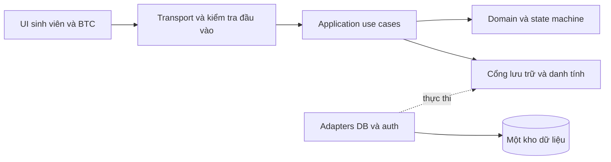

# Architecture Spine — Force

Bất biến đề xuất để các story dùng chung dữ liệu và quy tắc. Chưa có code ứng dụng, stack được chốt hoặc quyết định kiến trúc được duyệt. Khi chọn story, ghi rõ các AD được nhóm chấp nhận; không suy mọi AD đã được thông qua từ việc tạo file.

## Design Paradigm

Một ứng dụng phân lớp. UI/transport chuyển đầu vào thành use case; miền nghiệp vụ sở hữu quy tắc; hạ tầng thực thi cổng lưu trữ/xác thực. Không tách dịch vụ theo epic.



## Invariants & Rules

### AD-1 — Một nơi sở hữu đăng ký

- **Binds:** E-01…03, FR-02…12.
- **Prevents:** Mỗi epic có một danh sách/trạng thái riêng hoặc tự sửa số đếm.
- **Rule:** Registration sở hữu hồ sơ và chuyển trạng thái; Attendance dùng cùng Registration qua use case. Reporting chỉ đọc. UI và transport không ghi DB trực tiếp; hạ tầng không định nghĩa rule khác miền nghiệp vụ.

### AD-2 — State machine và định danh dùng chung

- **Binds:** FR-02/03/04/06/09/10/11; BR-02…08/12.
- **Prevents:** Một màn hình coi registered là đã tham dự hoặc mỗi nơi có định nghĩa trùng khác nhau.
- **Rule:** Core chỉ registered/checked/cancelled và chuyển trạng thái ở BUSINESS_RULES. Unique `(event_id, normalized_email)` gồm đã hủy; DB thực thi ràng buộc cùng validation miền. Chuẩn hóa, displayCode, thay đổi checkedAt/version và ma trận actor–command theo contract ARCHITECTURE.md. Internal ID, mã hiển thị và secret truy cập là ba trường khác nghĩa. MSSV/waitlist/pending cần quyết định thay đổi scope trước khi thêm.

### AD-3 — Mutation nguyên tử và lặp an toàn

- **Binds:** FR-02/03/06/09/10; NFR-02/03.
- **Prevents:** Hai máy ghi đè, trùng hồ sơ, tăng lượt tham dự hoặc mất audit sau retry.
- **Rule:** Mỗi command có requestKey và payload fingerprint. Thứ tự: xác thực/quyền hiện tại → receipt → version/state → mutation; replay cùng scope/key/payload trả kết quả của lượt đó, không chạy lại. Key cũ khác payload báo conflict. Chuẩn hóa payload và scope create/owner/BTC theo ARCHITECTURE.md. Mọi mutation kể cả create ghi hồ sơ, audit và receipt cùng một giao dịch ngắn; mutation có version đối chiếu expectedVersion. Không gọi email/dịch vụ ngoài trong transaction. Create dùng unique DB để quyết định cạnh tranh. Retry sau timeout trước hết đối soát cùng key; replay không giả định trạng thái hiện tại chưa đổi sau lượt gốc.

### AD-4 — Quyền nằm ở máy chủ và theo sự kiện

- **Binds:** FR-07…12; BR-09/14; NFR-01/05.
- **Prevents:** Sửa event ID để xem sự kiện khác hoặc dùng toolbar demo như phiên BTC.
- **Rule:** Principal BTC từ adapter xác thực; EventMembership ánh xạ principal + event tới read/check_in/undo_check_in/report/export. Mọi query/command kiểm tra quyền tương ứng và scope trước truy cập DB. Không tin role/event do client gửi. Phiên hết hạn từ chối; không tự chạy mutation cũ sau đổi principal.

### AD-5 — Quyền riêng của chủ hồ sơ

- **Binds:** FR-03…06; BR-03/05/14.
- **Prevents:** Dò mã tuần tự, email hoặc MSSV để lấy vé/hủy của người khác.
- **Rule:** Candidate core dùng secret ngẫu nhiên 256 bit được client tạo bằng bộ sinh mật mã trước lượt đăng ký; truyền trong body HTTPS, máy chủ lưu hash một chiều và ràng buộc với hồ sơ. Request replay của create phải khớp cả secret/payload gốc; key đơn lẻ không đủ lấy kết quả riêng. Tra cứu trao đổi secret lấy phiên chủ hồ sơ có cookie HttpOnly/Secure, giới hạn một hồ sơ; secret không ở URL/log/CSV/cache công khai. Rate-limit exchange/create. Mất secret chỉ xử lý theo quy trình đã chốt OQ-06, không fallback email/MSSV. Cơ chế này là đề xuất cần kiểm tra trước khi triển khai, không dùng FORCE-* làm secret.

### AD-6 — Contract và lỗi chung

- **Binds:** Mọi story; NFR-03/04.
- **Prevents:** Client/API tự suy DTO, nhãn state hoặc coi timeout là chắc chắn chưa lưu.
- **Rule:** Dùng chung enum, DTO và mã lỗi trong ARCHITECTURE.md; validation server có thẩm quyền. Thời điểm máy chủ UTC, hiển thị Asia/Ho_Chi_Minh. Không đổi state bằng GET; mutation chống CSRF phù hợp với cookie session. Kết quả lỗi mang code/requestId/fieldErrors an toàn; không trả stack/PII. Trạng thái chưa biết sau timeout là unknown đến khi đối soát; không tự sync offline.

### AD-7 — Báo cáo từ một snapshot

- **Binds:** FR-11/12; BR-12/13.
- **Prevents:** Preview và CSV lệch nhau hoặc aggregate có mẫu số khác danh sách.
- **Rule:** Summary tính trên một snapshot DB nhất quán. PrepareExport kiểm tra quyền export trước khi trả snapshot bất biến gồm rows/phạm vi/thời điểm; preview và tệp cùng serialize snapshot đó trong phiên trình duyệt. Không query lại khi bấm tải mà giữ preview cũ. Snapshot không chứa secret; serializer escape CSV và vô hiệu công thức. Đổi phạm vi/làm mới phải tạo snapshot mới. Quyền cấp snapshot kiểm tra ở server, log sự kiện cấp export không chứa PII.

### AD-8 — Môi trường và dữ liệu vận hành

- **Binds:** NFR-05/06, mọi deployment.
- **Prevents:** Fixture thành dữ liệu thật, secret nằm trong repo hoặc pilot không khôi phục được.
- **Rule:** Tách dev/test/pilot và credential; trước khi đóng OQ dùng fixture. Schema thay qua migration có version theo story, quyền DB tối thiểu; không dùng tài khoản quản trị cho query ứng dụng. Log requestId/actor ID/event ID/action/result không chứa secret hoặc nội dung form. Có sao lưu và thử restore trước pilot; lịch lưu/xóa, hosting, quy mô và người vận hành phải chốt ở OQ-08/09/10.

## Consistency Conventions

| Quan tâm | Quy ước |
| --- | --- |
| Hợp đồng | DTO camelCase; lớp lưu trữ chuyển mapping; state enum giữ nguyên registered/checked/cancelled |
| Định danh | ID nội bộ không phải quyền; mã hiển thị để đối chiếu; secret chỉ cho chủ hồ sơ |
| Thời gian | Server tạo UTC; API ISO 8601; UI nêu giờ Việt Nam; version là số tăng đơn điệu của hồ sơ |
| Lỗi | VALIDATION, DUPLICATE_REGISTRATION, NOT_AUTHENTICATED, FORBIDDEN, NOT_FOUND, STATE_CONFLICT, TEMPORARY_FAILURE, RATE_LIMITED |
| Mutation | Command idempotent; query không đổi state; nếu audit lỗi thì rollback mutation |
| UX | DESIGN sở hữu hình thức, EXPERIENCE sở hữu hành vi; cần cập nhật contract trước thêm variant |

## Structural Seed

```text
app/                 Trang và HTTP handlers của candidate framework
src/contracts/       DTO, enum, mã lỗi dùng chung
src/domain/          Rule đăng ký và state machine
src/application/     Use case, quyền, transaction boundary, cổng
src/infrastructure/  DB, repository, auth adapter
tests/               Kiểm tra rule, DB/concurrency, API quyền và luồng chính
```

Đây là seed chưa tạo trong repo; code sở hữu cấu trúc chi tiết sau bootstrap. Event có nhiều Registration và EventMembership; Registration có nhiều AuditEntry. Dedup record gắn phạm vi command/principal/event và kết quả lượt gửi. Tạo từng entity theo story thực sự dùng nó.

Vận hành seed: trình duyệt → một máy chủ ứng dụng → một DB; dev/test dùng fixture, pilot dùng môi trường/credential tách riêng. Không yêu cầu hàng đợi, cache phân tán, realtime hoặc dịch vụ gửi thư trong core.

## Capability → Architecture Map

| Phạm vi | Nơi xử lý | AD |
| --- | --- | --- |
| FR-01…06 / E-01 | Event query, Registration commands, OwnerAccess | AD-1/2/3/5/6/8 |
| FR-07…10 / E-02 | Identity, EventMembership, Attendance commands | AD-1/2/3/4/6/8 |
| FR-11/12 / E-03 | Reporting queries, export snapshot/serializer | AD-1/4/6/7/8 |

## Deferred

- Stack và starter: candidate cùng nguồn kiểm tra ở ARCHITECTURE.md; chọn phiên bản và pin lockfile trước bootstrap, OQ-02.
- Auth provider/thư viện và cấp membership: chốt OQ-02/07 trước US-06; không tự viết hệ thống mật khẩu để lấp khoảng trống.
- Retention, hosting, backup cadence/RPO/RTO và SLO: chốt OQ-08/09/10 trước dữ liệu thật; không cam kết số chưa đo.
- Email, QR/camera, MSSV, pending/waitlist, offline sync: thay đổi scope và AD liên quan trước khi bổ sung; không giao các phần này cho từng story tự lựa chọn.
- ORM, index phụ trợ, phân trang: chọn tại story có truy vấn/quy mô đo được; vẫn phải giữ AD-2/3/4/7, unique và scope DB. Không trì hoãn quyền/toàn vẹn tới bước tối ưu.

[Bản giải thích và contract](ARCHITECTURE.md) · [Nhật ký quyết định](.memlog.md)
